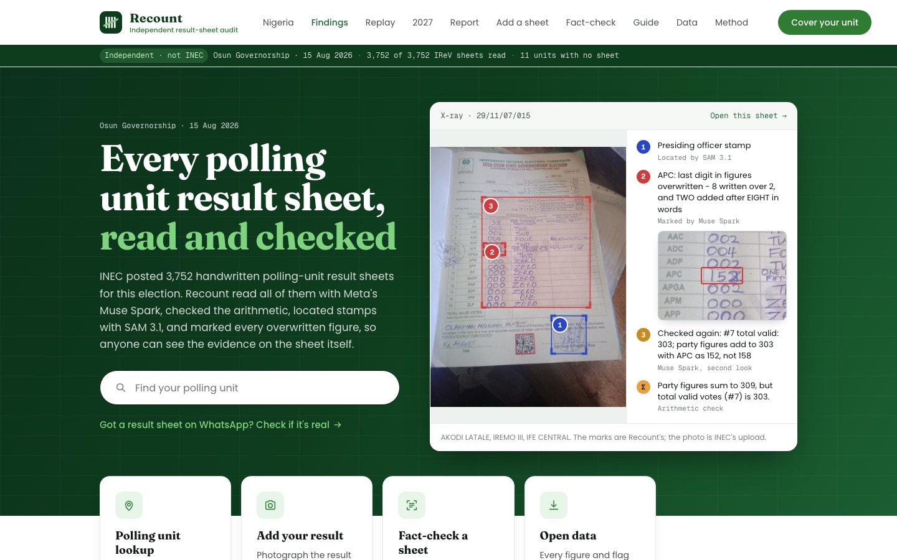
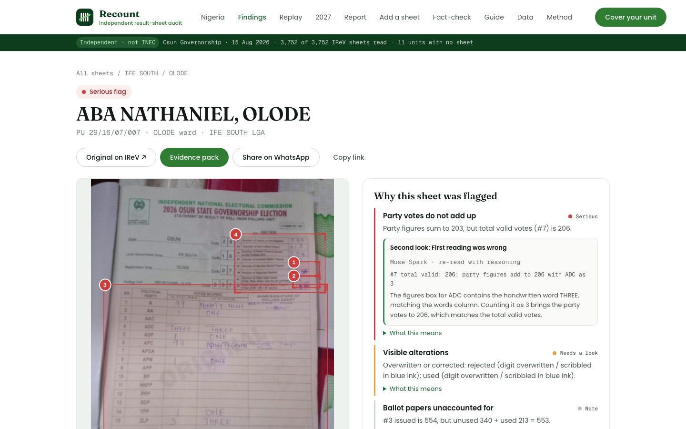
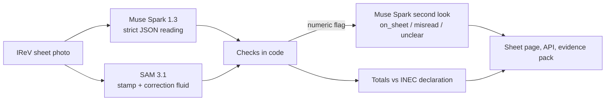

<div align="center">

# Recount

**Every Nigerian polling-unit result sheet, read and checked by Meta's Muse Spark.**

[Live site](https://recount.nerom.site) · [Demo video](https://youtu.be/owkRYab_Bqc) · [Write-up](submission/WRITEUP.md) · [API](https://recount.nerom.site/data)


*Meta Global AI Developer Hackathon · Indie track*



</div>

## Contents

- [Why](#why)
- [What it does](#what-it-does)
- [How it works](#how-it-works)
- [Results](#results)
- [Getting started](#getting-started)
- [Configuration](#configuration)
- [Scripts](#scripts)
- [API](#api)
- [Project structure](#project-structure)
- [Deployment](#deployment)
- [Responsible use](#responsible-use)
- [Data and credits](#data-and-credits)
- [License](#license)

## Why

Nigeria counts every vote by hand. At each of its 176,846 polling units, an officer writes the result on one paper form (Form EC8A), and a photo of it goes up on INEC's public results portal, [IReV](https://www.inecelectionresults.ng). The count is public, but only as handwritten images, and nobody reads all of them. Disputes end up being fought with forwarded WhatsApp photos and with figures that change between the polling unit and the collation centre.

Recount reads every sheet, checks each one against itself, and lets anyone check a sheet they've been sent against INEC's original. It's built for Nigeria's next general election on **16 January 2027**.

## What it does

| | |
|---|---|
| **Reads every sheet** | Muse Spark 1.3 copies each IReV photo into strict JSON: unit codes, voters, ballot accounting, every party's score in figures *and* in words, stamp, signature and every overwritten entry, with a box around it |
| **Checks the arithmetic** | Plain code (not the model) runs fixed checks: votes that don't add up, more votes than accredited voters, figures against words, missing stamp, unaccounted ballots, a sheet filed under the wrong unit |
| **Takes a second look** | For every numeric flag, Muse Spark goes back to the image with reasoning on and says whether the problem is on the paper or was a misreading |
| **Finds physical evidence** | SAM 3.1 locates the official stamp and any correction fluid from a text prompt |
| **Adds it all up** | Unit results roll up to ward, LGA and state, and are compared with INEC's declaration, with a margin-of-lead test and an election-night upload replay |
| **Fact-checks forwarded sheets** | Upload a photo you were sent; Recount finds the unit, pulls the original and compares the two like a document examiner |
| **Checks collation sheets** | Photograph a ward sheet (EC8B); every row is checked against the polling-unit sheets beneath it |
| **Situation room** | Voters report what they see at their unit (late officials, BVAS down, vote buying); two matching reports mark it confirmed |
| **Evidence packs** | SHA-256 fingerprints of every sheet as IReV served it, for use at a tribunal |
| **WhatsApp** | Forward a sheet, send a unit code, or `REPORT <code>`, through the WhatsApp Cloud API |
| **Open data** | JSON and CSV exports, an RSS feed of changes and an [OpenAPI spec](https://recount.nerom.site/api/openapi.json) |



## How it works



| Job | Model | Notes |
|---|---|---|
| Read public IReV sheets | `muse-spark-1.3-contributor`, reasoning low | Only for INEC's already-public images, which keeps a whole state affordable |
| Second look at numeric flags | `muse-spark-1.3`, reasoning medium | Re-reads only the entries each flag depends on |
| Fact-check a forwarded photo | `muse-spark-1.3`, reasoning medium | Two images in: same physical sheet? What changed, where, and how? |
| Read collation sheets | `muse-spark-1.3`, reasoning low | 9–30 rows × 15 parties against a strict schema |
| Stamp and correction fluid | `sam-3.1` | Text prompts `"round stamp"` and `"correction fluid"`, boxes parsed from the stream |

Citizens' uploads never go through contributor mode. Every flag comes from code reading the model's structured output, never from prose. A figure the model can't read comes back `null`, not a guess.

## Results

| Election | Sheets read | Flagged | Notes |
|---|---:|---:|---|
| Osun governorship, 15 Aug 2026 | 3,752 / 3,752 | 1,241 | Sum of sheets within **0.11%** of INEC's declaration for both leading parties |
| Ekiti governorship, 20 Jun 2026 | 2,390 / 2,390 | 893 | 194 sheets show over-voting |
| Anambra governorship, 8 Nov 2025 | 5,634 / 5,711 | 2,288 | 428 sheets show over-voting |

**Second look:** in Osun, Muse Spark re-checked 1,410 numeric flags. 86% were confirmed on the paper, 12% were the first reading's mistakes and 1% couldn't be settled from the photo. On 48 sheets, every serious numeric flag turned out to be a misreading. In Ekiti the split was 981 confirmed, 112 misread and 15 unclear.

The full method and findings are in the [write-up](submission/WRITEUP.md).

## Getting started

**Requirements:** Node.js 22+ and a Meta Model API key (`api.meta.ai`). The API is region-gated, so run the reading scripts from a region where it's offered.

```bash
git clone https://github.com/neromtoobad/recount.git
cd recount
npm install
echo "MODEL_API_KEY=your-key" > .env
```

The indexes for Osun, Ekiti and Anambra are in `data/`. Read a few sheets and start the app:

```bash
npm run analyze -- osun --limit 20
npm run dev
```

The API runs on http://localhost:8791 and the web app on http://localhost:5181.

To index a different IReV election, pass its IReV election id and a slug:

```bash
npm run index -- <electionId> <slug>
```

## Configuration

Set these in `.env`. Only `MODEL_API_KEY` is needed to read sheets locally.

| Variable | Used by | Purpose |
|---|---|---|
| `MODEL_API_KEY` | scripts | Meta Model API key |
| `SPARK_PUBLIC_MODEL` | scripts | Model for public sheets (default `muse-spark-1.3-contributor`) |
| `DATA_DIR` | server, scripts | Where indexes and analyses live (default `data`) |
| `PUSH_URL` | scripts | Hosted site that results are pushed to |
| `INGEST_TOKEN` | server, scripts | Bearer token shared by the reader and the hosted site |
| `IMAGE_PROXY_BASE` | scripts | Fetch IReV images through the hosted `/img` proxy |
| `PUBLIC_ORIGIN` | server | Public URL used in links, the OpenAPI spec and feeds |
| `LIVE_CHECK` | server | Set to `off` to turn off live fact-checks |
| `WHATSAPP_TOKEN`, `WHATSAPP_PHONE_ID`, `WHATSAPP_VERIFY_TOKEN`, `WHATSAPP_APP_SECRET`, `WHATSAPP_DISPLAY_NUMBER` | server | WhatsApp Cloud API |

## Scripts

| Command | What it does |
|---|---|
| `npm run dev` | API and web app with reload |
| `npm run build` / `npm start` | Production build, then serve the API and the built site |
| `npm run index -- <id> <slug>` | Index every polling unit and sheet URL of an IReV election |
| `npm run analyze -- <slug> [--limit N] [--lga NAME] [--concurrency N] [--retry-errors] [--push]` | Read sheets with Muse Spark and SAM 3.1, then run the checks |
| `npx tsx scripts/review.ts <slug> [--limit N] [--concurrency N] [--no-push]` | Second look at every sheet with a numeric flag |
| `npm run copies -- <slug> [--watch]` | Work the hosted queue: citizen copies, fact-checks and WhatsApp checks |
| `npx tsx scripts/push.ts <slug>` | Send every local analysis to the hosted site |
| `node scripts/registry.mjs` | Build the national registry of all 176,846 units |

## API

The full spec is at [`/api/openapi.json`](https://recount.nerom.site/api/openapi.json). The main endpoints:

| Endpoint | Returns |
|---|---|
| `GET /api/elections` | Elections Recount has read |
| `GET /api/:slug/summary` | Totals, flags and the comparison with INEC's declaration |
| `GET /api/:slug/units` | Polling units with their readings and flags, filterable and paginated |
| `GET /api/:slug/pu/:id` | One sheet: reading, flags, second look and evidence boxes |
| `GET /api/:slug/export.csv`, `/export.json` | Bulk export |
| `GET /api/:slug/pack` | Evidence pack with SHA-256 fingerprints |
| `GET /api/:slug/feed.xml` | RSS feed of changed uploads |
| `GET /api/nigeria/unit/:code` | Any unit in the country by its code |
| `POST /api/check` | Queue a forwarded sheet for a fact-check |

## Project structure

```
server/            Hono API
  lib/reader.ts      Muse Spark sheet reader
  lib/sam.ts         SAM 3.1 stamp and correction-fluid detection
  lib/checks.ts      the sheet checks
  lib/review.ts      second look
  lib/compare.ts     two-image forensic comparison
  lib/collation-sheet.ts
  lib/pack.ts        evidence packs
  lib/whatsapp.ts
web/               Vite + React front end
scripts/           indexing, reading, review, queue worker, push
data/              election indexes (analyses stay local)
video/             the demo video, an HTML composition rendered with headless Chrome + ffmpeg
submission/        hackathon write-up
```

## Deployment

The Meta Model API answers from Nigeria but not from the cloud regions the host offers, so Recount runs in two parts:

- **Hosted site (Railway):** serves the pages, the API and an image proxy, and queues any upload that needs Muse Spark. `railway.json` builds with `npm run build` and starts with `npm start`; mount a volume at `DATA_DIR`.
- **Reader (a machine in an allowed region):** runs `analyze`, `review` and `copies --watch`, and pushes results to the hosted site with `PUSH_URL` and `INGEST_TOKEN`.

## Responsible use

Recount is independent and non-partisan, and it is not INEC. It doesn't declare winners. A flag means "look at this sheet again", not fraud, and every explanation describes the paper, never a person or party. Citizen uploads are read with the standard model, not contributor mode, and no personal data is collected. Please never photograph a marked ballot.

## Data and credits

- Result sheets are public records published by INEC on IReV.
- The demo video uses Voice of America footage (public domain) and Wikimedia Commons photos by Iyusuf615, Yemi Festus and Harryman4ever (CC BY-SA 4.0). Full credits are in the [write-up](submission/WRITEUP.md#demo-video-credits).
- Built with Muse Spark 1.3 and SAM 3.1 on the Meta Model API.

## License

The code is released under the [MIT License](LICENSE). The IReV sheet images, the VOA footage and the Commons photos keep their own terms, listed above.
